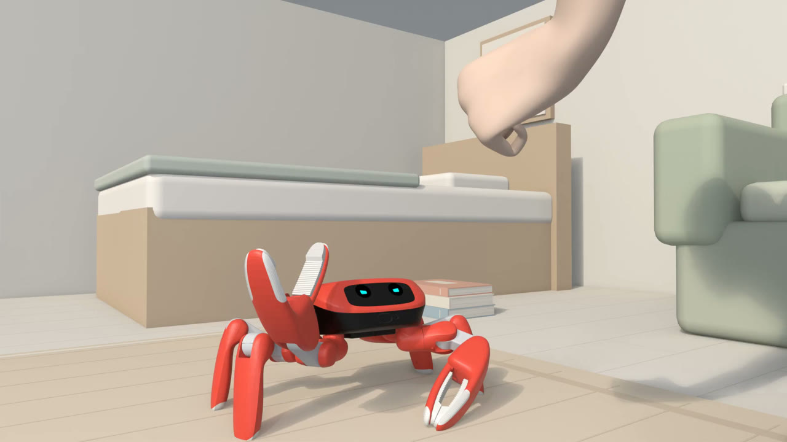
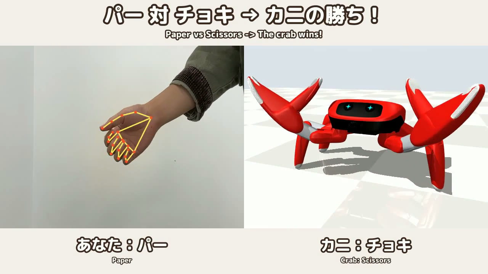

# Scissors Crab ✂️🦀

**English** | [日本語](README.ja.md)



*Everyone jokes that crabs can only throw scissors.* So we taught
[Jumper](https://github.com/KingKongRobotics/jumper), KingKong's open-source 22-DoF crab
robot, to play rock-paper-scissors: a shy crab that can only ever throw scissors, and
reacts to however the game turns out. Every motion is a policy trained with the official
toolkit to imitate a keyframed performance, running in MuJoCo physics.

An entry for the [Crab Robot Open-source Challenge 2026](https://beunlimited.me/en/events/crab-robot-challenge-2026).

| Watch | |
|---|---|
| [**The film**](https://x.com/RyotaN_lab/status/2110720632124326216) (22 s) | The crab loses to rock, beats paper, and meets another crab |
| [**Play it live**](https://x.com/RyotaN_lab/status/2115367396248793294) (24 s) | A webcam reads your hand; the three trained policies answer in real time |

**All of this is simulation. None of it has run on the real robot yet.**

## What the crab does

Each game starts the same way -- a fist for "rock, paper", then scissors on "shoot!" --
and then branches into one of three outcomes, each its own trained policy:

| Outcome | Task | What happens |
|---|---|---|
| Rock beats it | `jumper.janken_lose` | A start, a frozen stare, the head sinking, the claws dropping, tears |
| It beats paper | `jumper.janken_win_jump` | Claws up, two jumps, a snip-snip with both claws -- then it remembers itself and hides its face behind its claws, peeks, hides again |
| Scissors vs. scissors | `jumper.janken_draw` | A dead-pan stare and "aiko de sho!": throw again, and again -- the clip loops seamlessly |

The eyes are the robot's own two round displays, drawn in the official face style
(cyan on black) with ten expressions, and also written out at the displays' 132×132.

## How it was made

1. **Choreography.** `blender/build_rig.py` generates a Blender rig straight from the
   training model `assets/jumper/jumper.xml` (forward kinematics agree to 0.0001 mm),
   with each joint limited to the model's range. Each reaction is keyframed on it.
2. **Training clips.** `tools/keyframes_to_npz.py` turns the keyframes into the
   imitation clip the toolkit trains on. The rig only animates joints, so the base's
   height and tilt are solved from the feet's ground contact (a jump adds the height it
   was lifted by in Blender), and sudden tilts are eased.
3. **Training.** Imitation RL with the official toolkit, on a Colab GPU
   (`colab/scissors_crab_colab.ipynb`). Mean joint tracking error against the
   choreography: 2.2° (lose), 1.7° (draw), and for the win 1.8–1.9° outside the jump and
   5.6° inside it, where the legs straighten further than choreographed. The draw
   loops with a 0.4° joint and 0.2 mm base mismatch at the seam.
4. **Rendering.** The trained policy is replayed and its full state recorded every step
   (`scripts/play.py --qpos-out`, added to the official script), then put back on the
   rig in Blender with the eye animation, on the official `home.map` set, opposite a
   human who plays the game in time with the crab.

### Getting the victory jump off the floor

At first the victory jump never left the floor -- just very enthusiastic squats. Two
things in the reward were against it:

- it scored only how close the **pose** was to the choreography, so leaving the floor
  earned nothing;
- the power and torque penalties made a push-off expensive. Measured on the official
  jump's own reference motion, the push-off costs 4.7 a step on average (17 at most),
  more than the best possible reward of 6.5.

`tasks/jumper/common/janken_jump.py` finds the jump in the clip and, **inside that
window only**, lifts the two penalties and adds the three terms the official
`jumper.jump` task trains with: base height, vertical velocity, and which feet touch the
ground. Outside the window the task is unchanged. The base now peaks at 157 mm (the
choreography: 163 mm; before: 130 mm), and on both hops the feet leave the floor --
by about 6 mm for 0.06 s, against 33.6 mm in the choreography. Airborne, but not high.

## Play it live



`interactive/janken_cam.py` reads your hand from the Mac's camera with MediaPipe and
plays against you in real time. All three policies run live, one environment each, in
one process on the CPU:

- Hands are mid-throw on the beat itself, so the hand is read **0.2–0.5 s after
  "shoot"** (the majority over that window) while the crab holds its scissors.
- Rock: the crab loses. Paper: it wins. Scissors, or no hand seen: a draw, and you throw
  again on each "shoot" until someone wins.
- On "shoot" the running environment hands its physical state -- joint and base
  positions and velocities, and the last actions -- to the environment of the outcome,
  set to the same point of its clip. The clips share their opening frame for frame, so
  the crab carries on from where it stands; nothing is a recording.
- The eyes are drawn onto the two displays of the face, so they disappear when the crab
  hides behind its claws.

```bash
# Once: MediaPipe, and Google's gesture model (8.4 MB, not in the repository)
.venv/bin/python -m pip install mediapipe==1.1.1
mkdir -p scissors_crab/external/models
curl -L -o scissors_crab/external/models/gesture_recognizer.task \
    https://storage.googleapis.com/mediapipe-models/gesture_recognizer/gesture_recognizer/float16/latest/gesture_recognizer.task

# Play: space starts a round, r / p / s force a throw, q quits
.venv/bin/python scissors_crab/interactive/janken_cam.py

# Without a camera, on a script
.venv/bin/python scissors_crab/interactive/janken_cam.py --no-camera --headless \
    --script "start@0.5,rock@1.5" --seconds 10 --record check.mp4
```

It loads the three trained checkpoints and their eye animations from
`scissors_crab/renders/<task>/<commit>/` (the paths are at the top of the script). Those
are not in the repository, so train and record the three tasks first (below).
`--read-from 0.3 --decide-at 0.6` moves the reading window.
The first run asks macOS for camera access for the terminal.

## Reproducing it

Python 3.10–3.13 with `pip install -e .` (see the official
[PROJECT_GUIDE](../docs/PROJECT_GUIDE.md)), and Blender 4.2 or later.

```bash
# 1. Generate the rig (once, and whenever the model changes)
blender --background --python scissors_crab/blender/build_rig.py

# 2. Open scissors_crab/blender/jumper_rig.blend, save it as
#    scissors_crab/motions/<name>.blend and keyframe the joints (frame 1 is HOME).

# 3. Export the keyframes
blender scissors_crab/motions/janken_lose.blend --background \
    --python scissors_crab/blender/export_keyframes.py

# 4. Convert them to a training clip, and look at it before training
.venv/bin/python scissors_crab/tools/keyframes_to_npz.py \
    scissors_crab/motions/janken_lose.keyframes.json --task janken_lose
.venv/bin/python scissors_crab/tools/preview_clip.py \
    tasks/jumper/janken_lose/media/janken_lose.npz --out preview.mp4

# 5. Train (a CPU smoke test here; the real runs were on Colab)
.venv/bin/python scripts/train.py --task jumper.janken_lose \
    --backend native --device cpu --num_envs 64 --max-iterations 5

# 6. Record the trained policy, draw the eyes, render in Blender
.venv/bin/python scripts/play.py --task jumper.janken_lose --headless --num_envs 1 \
    --steps 290 --qpos-out scissors_crab/renders/janken_lose/rollout.npz
.venv/bin/python scissors_crab/tools/make_eyes.py scissors_crab/motions/janken_lose.eyes.json \
    --duration 5.8 --out scissors_crab/renders/janken_lose/eyes
blender scissors_crab/blender/jumper_rig.blend --background \
    --python scissors_crab/blender/import_motion.py -- \
    scissors_crab/renders/janken_lose/rollout.npz \
    --eyes scissors_crab/renders/janken_lose/eyes \
    --render scissors_crab/renders/janken_lose/janken_lose.mp4
```

On Colab: [open the notebook](https://colab.research.google.com/github/RyotaNishioka9623/jumper_project/blob/main/scissors_crab/colab/scissors_crab_colab.ipynb).
Iterations used: 1500 for lose and draw, 4000 for win_jump.

The staged shots of the film (set, human, lighting, 1920×1080), the captions and the
sound are made by `blender/stage.py`, `blender/ending.py`, `edit/make_scissors_crab.py`
and `tools/edit.py`; the exact commands are in [README.ja.md](README.ja.md#本番の動画を作る).
The set, the human, the font and the sound effects live in `renders/` and `external/`,
outside git.

## What is where

| Path | |
|---|---|
| `tasks/jumper/janken_*/` | One task per outcome: `janken_lose`, `janken_win_jump`, `janken_draw`, and the earlier `janken_win` and `janken_win_hop` |
| `tasks/jumper/common/janken.py` | What the janken tasks share; numbers such as reward scales are computed from the clip |
| `tasks/jumper/common/janken_jump.py` | The jump window, its reward terms and the penalties lifted inside it |
| `scissors_crab/blender/` | The rig, keyframe export, motion import, the set, the human, staging and the closing shot |
| `scissors_crab/motions/` | The choreography `.blend` files, their keyframe tables, and the eye timelines (`.eyes.json`) |
| `scissors_crab/tools/` | Clip conversion and preview, the eyes, the editor, and the X character counter |
| `scissors_crab/interactive/janken_cam.py` | The live version |
| `scissors_crab/edit/` | The edit lists of both videos |
| `rl/mjrl/viewer/qpos_log.py` | The per-step state recording behind `play.py --qpos-out` |

## Credits and licences

- Built on [KingKongRobotics/jumper](https://github.com/KingKongRobotics/jumper), whose
  history this repository carries; Apache-2.0, as is everything added here.
- Set: `library/maps/home.map` from
  [KingKongRobotics/jumper-design](https://github.com/KingKongRobotics/jumper-design).
- Human: Blender Studio's Human Base Meshes (CC0).
- Font: M PLUS Rounded 1c (SIL Open Font License).
- Sound effects: 効果音ラボ (Sound Effect Lab), not redistributed here.
- Hand reading: [MediaPipe](https://github.com/google-ai-edge/mediapipe)'s gesture
  recognizer; the model is downloaded separately.

## What has not been done

- **Nothing here has run on the real robot.** The film and the live version are both
  simulation.
- The jump leaves the floor by millimetres, not centimetres.
- Next, given a real Jumper: run the policies on it, and read the hand with its own
  front camera instead of a webcam.
